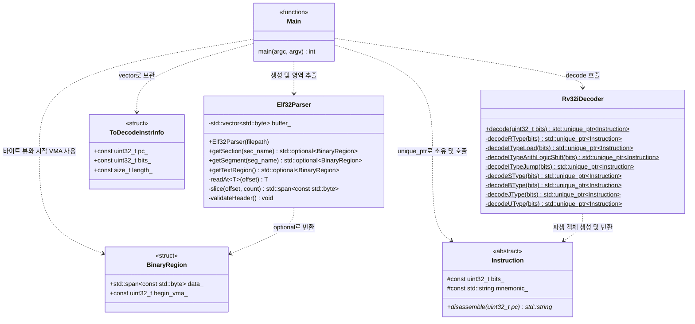
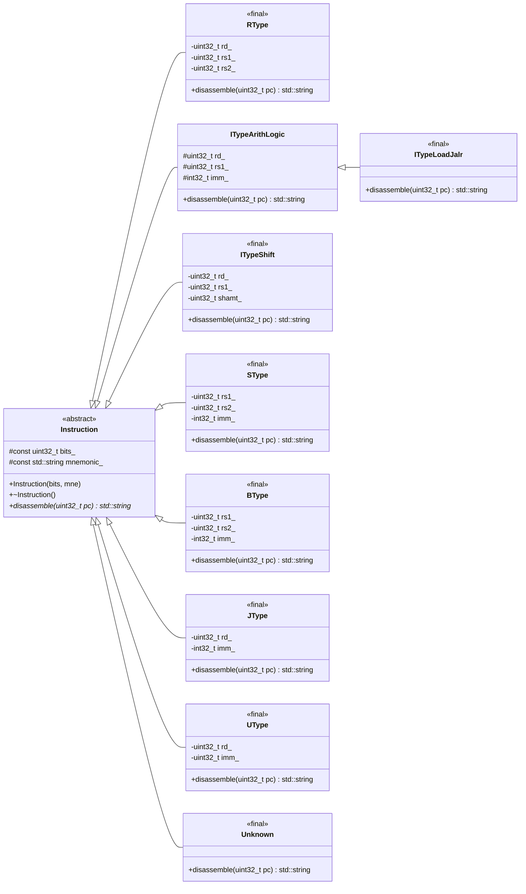

# RV32I Disassembler — UML

기준 커밋: [`4785541`](https://github.com/Jun19204/rv32i-disassembler-engine/tree/4785541a001ba22de242ab9bbd864ef8151fadbd)

실제 구현을 바탕으로 전체 의존 관계와 명령어 상속 관계를 나누어 표시한다. 반복되는 생성자와 일부 구현 세부 사항은 생략한다.

## 1. 전체 구조

`Main`은 클래스가 아닌 `main()` 자유 함수를 나타낸다. 메서드의 `const` 한정자는 가독성을 위해 생략했다.

### 소유권과 수명

- `Elf32Parser::buffer_`가 ELF 파일의 바이트 데이터를 소유한다.
- `BinaryRegion::data_`는 해당 버퍼의 일부를 참조하는 비소유 `std::span`이다. `BinaryRegion`을 복사해도 바이트 데이터는 복사되지 않는다. 뷰를 사용하는 동안 원본 버퍼가 유효해야 한다.
- `Rv32iDecoder`는 생성한 명령어를 멤버로 보관하지 않는다. `std::unique_ptr<Instruction>`을 반환하여 호출자에게 소유권을 전달한다.
- `main()`의 `decoded_instr`가 반환된 객체를 소유한다. `Instruction`의 가상 소멸자를 통해 파생 객체가 올바르게 소멸한다.

## 2. 명령어 상속 구조

모든 구체 명령어 클래스는 `rv32i_decoder.cpp`의 익명 네임스페이스에 정의되어 있다. 외부 공개 인터페이스는 `Instruction`과 `Rv32iDecoder`이다.

`ITypeLoadJalr`는 `ITypeArithLogic`의 생성자를 상속하여 `rd_`, `rs1_`, `imm_` 추출을 재사용하고, 출력 형식만 재정의한다. `ITypeArithLogic`은 자체적으로도 생성되는 구체 클래스이다.

`Instruction::disassemble()`은 순수 가상 함수이며 모든 구체 클래스에서 재정의한다. `Instruction`의 소멸자는 가상 함수이다. `Unknown`은 생성자를 `Instruction`으로부터 상속하고 `"unknown"`을 출력한다.

## 3. 파일별 구성

| 파일 | 주요 구성 요소 |
| --- | --- |
| `elf32_parser.h` | `BinaryRegion`, `Elf32Parser`, 시스템 `elf.h`가 없는 경우의 ELF 구조체 정의 |
| `elf32_parser.cpp` | 파일 로딩, 헤더 검증, 섹션 및 세그먼트 탐색 |
| `rv32i_decoder.h` | `Instruction`, `Rv32iDecoder` |
| `rv32i_decoder.cpp` | 구체 명령어 클래스, `Opcode` 열거형, 디코딩 팩토리 구현 |
| `disasm-rv32i.cpp` | `main()`, `ToDecodeInstrInfo`, `UnsignedInteger`, `readLE()` |

## 표기

| 표기 | 의미 |
| --- | --- |
| `+` / `-` / `#` | `public` / `private` / `protected` |
| 빈 삼각형 실선 화살표 | 상속 관계. 화살표가 부모 클래스를 가리킴 |
| 점선 화살표 | 사용 또는 생성에 따른 의존 관계 |
| `abstract` | 추상 클래스 |
| `final` | 추가 상속을 금지한 클래스 |
| 메서드 끝의 `*` | 추상 메서드. Mermaid에서 기울임꼴로 표시 |
| 메서드 끝의 `$` | 정적 메서드. Mermaid에서 밑줄로 표시 |

ELF 헤더 구조체와 표준 라이브러리 타입의 내부 구조, `Opcode` 및 자유 보조 함수는 클래스 다이어그램에서 생략했다.
